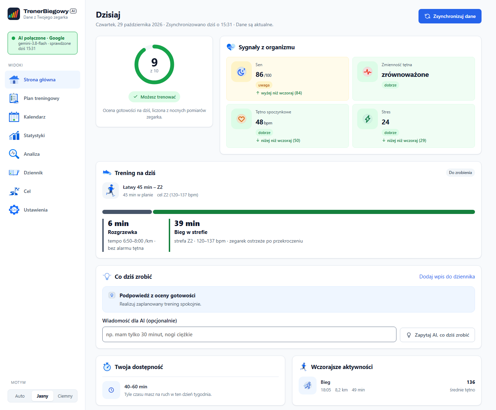

<h1>
  <picture>
    <source media="(prefers-color-scheme: dark)" srcset="docs/images/logo-dark.png">
    
  </picture>
</h1>

Lokalny trener biegowy dla zegarków Garmin. Pobiera Twoje dane z Garmin Connect, codziennie ocenia gotowość do treningu (sen, HRV, tętno spoczynkowe, stres), układa z pomocą AI plan na tydzień i wysyła treningi na zegarek. Działa w przeglądarce, ale wyłącznie na Twoim komputerze — dane nie trafiają na żaden serwer aplikacji.

> To nie jest porada medyczna. Decyzja o treningu należy do Ciebie.

<picture>
  <source media="(prefers-color-scheme: dark)" srcset="docs/images/screenshot-dark.png">
  
</picture>

<sub>Zrzut na danych przykładowych (`python scripts/demo_server.py`).</sub>

## Zacznij tutaj (Windows, bez terminala)

1. Pobierz najnowszą paczkę **`TrenerBiegowyAI-<wersja>.zip`** z [Releases](https://github.com/mdanielak/TrenerBiegowyAI/releases) i rozpakuj ją w wygodnym miejscu.
2. Kliknij dwukrotnie **`install.bat`**. Instalator sprawdzi Pythona 3.11+ (jeśli go brakuje, zaproponuje instalację przez Microsoft winget), zainstaluje pakiety i utworzy na pulpicie skrót **„Trener Biegowy”**. Szczegóły ewentualnych błędów trafiają do `local\install.log`.
3. Uruchom skrót **„Trener Biegowy”** (albo `start.bat`). Przeglądarka otworzy się sama pod adresem http://127.0.0.1:8001.
4. Strona poprowadzi Cię dalej: połączenie konta Garmin (z kodem weryfikacyjnym, jeśli Garmin o niego poprosi), pierwsze pobranie danych z zegarka i kreator celu.
5. Opcjonalnie podłącz AI w **Ustawienia → API AI**. Samouczek prowadzi krok po kroku przez trzy opcje:

| Opcja | Koszt | Prywatność |
| --- | --- | --- |
| **Google Gemini** (zalecane) | darmowy limit wystarcza na codzienne użycie | w EOG Google nie używa zapytań do ulepszania produktów |
| **DeepSeek Flash** | płatne z góry, bardzo tanie (ułożenie planu to zwykle ułamek centa) | dane przetwarzane na serwerach DeepSeek w Chinach |
| **Ollama** | 0 zł | dane nie opuszczają komputera; potrzebny mocniejszy sprzęt |

Bez AI działa wszystko poza układaniem planu, rekomendacją dnia i komentarzem do treningu.

### Aktualizacja

Kliknij dwukrotnie **`update.bat`**. Sprawdzi najnowsze wydanie na GitHubie, pobierze je i podmieni pliki aplikacji, a potem zaktualizuje pakiety. Twoje dane — `local/`, `.env`, plany i własna strategia — zostają bez zmian. Możesz też pobrać paczkę ZIP ręcznie i **przeciągnąć ją na `update.bat`**. W kopii repozytorium git `update.bat` robi po prostu `git pull`.

**Hasło do Garmina** wpisujesz raz; jest tylko w pamięci na czas logowania i nie trafia na dysk, do logów ani do `.env`. Zostaje token konta, który sam się odnawia. W **Ustawienia → Zegarek Garmin** możesz w każdej chwili odłączyć zegarek i usunąć dane logowania.

## Co potrafi

| Adres | Widok |
| --- | --- |
| `/` | dzisiaj: gotowość, sygnały z organizmu, trening na dziś rozpisany jak na zegarku, rekomendacja AI, synchronizacja z paskiem postępu |
| `/plan` | plan tygodniowy: wiadomość dla AI, cel tygodnia, dzień po dniu, wysyłka na zegarek |
| `/week` | kalendarz tygodnia: plan a wykonanie z zegarka |
| `/stats` | statystyki 4/8/12 tygodni: kilometry, plan a wykonanie, trendy sygnałów |
| `/analysis` | skąd wzięła się dzisiejsza ocena gotowości |
| `/journal` | dziennik samopoczucia, RPE i bólu oraz przerwy (choroba, wyjazd, zabieg) |
| `/goal` | cel długoterminowy: odliczanie, fazy strategii i kryteria gotowości |
| `/settings` | połączenia (Garmin, AI), profil biegacza, strefy tętna, cele |

Motyw jasny albo ciemny wybierzesz na dole menu (**Auto** dopasowuje się do ustawień systemu). Serwer działa tylko na `127.0.0.1` — nie ma go w sieci.

## Prywatność

Wszystkie Twoje dane leżą w katalogu projektu i w Twoim katalogu domowym:

- `local/` — profil, snapshot danych z zegarka, dziennik, przerwy, rekomendacje, stan zadań,
- `training-plans/{RRRR-MM}/` — ułożone plany tygodniowe,
- `training-plans/long-term/half-marathon-2027.md` — Twoja strategia długoterminowa (patrz niżej),
- `~/.GarminDb/` — token Garmina i baza GarminDB,
- `.env` — ustawienia AI i e-mail konta Garmin.

Żadna z tych ścieżek nie jest śledzona przez Git. Do AI trafiają dane tylko po włączeniu zgody na eksport w Ustawienia → API AI, i wtedy głównie agregaty: średnie z 7 dni wobec 12 tygodni, kilometry z 4 tygodni, 7 ostatnich biegów i podsumowanie dziennika.

## Strategia długoterminowa

Strona Cel czyta fazy przygotowań i kryteria gotowości z pliku `training-plans/long-term/half-marathon-2027.md`; ta sama strategia trafia do AI przy układaniu planu. Plik zawiera dane o Tobie (historia biegów, rekordy, cele), więc zostaje na komputerze i nie jest śledzony.

Na początek skopiuj przykład [`przyklad-strategii.md`](training-plans/long-term/przyklad-strategii.md) jako `half-marathon-2027.md` i wpisz własne daty, objętości oraz cele. Parser oczekuje tabeli z nagłówkiem „Periodyzacja” (daty w formacie `28.09—20.12.2026`) i sekcji „Kryteria gotowości”. Przykład nigdy nie zastępuje Twojej strategii — bez niej strona Cel podpowie, co zrobić, a AI planuje bez strategii.

## Linux i macOS

```bash
python3 -m venv .venv
./.venv/bin/python -m pip install -r requirements.txt
./start.sh
```

Pełne instrukcje: [Linux](docs/linux_setup.md) oraz [Windows](docs/windows_description.md).

## Dla zaawansowanych: wiersz poleceń

To samo, co w przeglądarce, można zrobić z terminala:

```bash
python -m trainer setup          # logowanie do Garmina, profil i strefy z Garmin Connect
python -m trainer sync           # synchronizacja danych (pierwszy raz: sync --fresh)
python -m trainer today          # ocena dnia
python -m trainer plan           # ułóż plan tygodnia (--show, --push, --week 2026-10-26)
python -m trainer analyze        # analiza gotowości (--ai)
python -m trainer profile --sync # odśwież profil z Garmin Connect
python -m trainer zones --sync   # odśwież strefy tętna
python -m trainer pause          # przerwy treningowe
python -m trainer doctor         # diagnostyka instalacji
python -m trainer privacy-check  # kontrola prywatnych ścieżek przed commitem
```

Pomoc: `python -m trainer --help` oraz `--help` przy każdej podkomendzie. Wynik synchronizacji może być częściowy — przed decyzją treningową sprawdź aktualność danych.

### Plan tygodniowy

„Ułóż plan” (albo `python -m trainer plan`) układa tydzień pon–niedz. AI dostaje profil, dostępność dni, przerwy, ostatnie biegi, gotowość, trendy z 12 tygodni, podsumowanie dziennika z 7 dni i wiadomość na ten tydzień; twarde reguły — dni wolne, okna minut, limit treningów jakościowych, przerwy — egzekwuje lokalny kod. Plan zapisuje się w `training-plans/{RRRR-MM}/{d}-{d}.json` obok pliku CSV.

Ani „Ułóż plan”, ani „Wyślij do Garmina” niczego nie nadpisują bez pytania. Przy kolizji pojawia się lista dni i trzy decyzje:

| Akcja | Nadpisz | Dodaj obok | Anuluj |
| --- | --- | --- | --- |
| Ułóż plan | obecne pliki tygodnia trafiają do `training-plans/{RRRR-MM}/archive/`, nowy plan obowiązuje | nowy plan zapisuje się jako druga wersja w `variants/`; porównasz ją dzień po dniu | nic się nie zmienia |
| Wyślij do Garmina | najpierw wysyłka, potem usunięcie kolidujących treningów z Garmina (zostają w rejestrze; odtworzysz je poleceniem `python -m trainer workouts restore`) | nowe treningi trafiają obok istniejących | nic nie jest wysyłane |

Treningi na zegarku rozpoznawane są z lokalnego rejestru, więc trening dodany ręcznie w Garmin Connect nie zostanie wykryty. W skryptach użyj `--on-conflict overwrite|add|cancel`.

### Gotowość, baner zdrowia i przerwy

Ocena gotowości (0–10) sumuje punkty za tętno spoczynkowe, HRV, sen i stres, które zegarek faktycznie zmierzył; szczegóły są na stronie Analiza. Gdy ocena wynosi „dziś lepiej odpuść”, HRV od kilku dni jest niskie albo w dzienniku zapisano ból, na górze strony głównej pojawia się baner z powodami.

Przerwy z Dziennika (albo `python -m trainer pause`) zapisują się w `local/training_preferences.json`. W tych dniach plan proponuje odpoczynek, a strona główna pokazuje przerwę zamiast treningu z planu ułożonego wcześniej.

### Zakres danych

Snapshot (`local/data_latest.json`) zawiera wszystkie aktywności z ostatnich 120 dni oraz 90 dni tętna spoczynkowego, stresu, snu i HRV. Okna liczone są od najnowszego rekordu w bazie GarminDB.

## Konfiguracja `.env`

Plik `.env` w katalogu projektu jest wczytywany automatycznie i ignorowany przez Git; formularz Ustawienia → API AI zapisuje go za Ciebie. Zmienne środowiskowe systemu mają pierwszeństwo przed `.env`. Wzór: `.env.example`.

| Zmienna | Przeznaczenie |
| --- | --- |
| `HEALTH_DATA_DIR` | katalog danych GarminDB, domyślnie `~/HealthData` |
| `SNAPSHOT_TTL_SECONDS` | po ilu sekundach snapshot uznawany jest za nieaktualny |
| `GARMIN_EMAIL` | adres konta Garmin |
| `AI_BASE_URL` | adres API zgodnego z OpenAI (np. Gemini, DeepSeek, Ollama) |
| `AI_API_KEY` | klucz API |
| `AI_MODEL` | nazwa modelu |
| `AI_DATA_EXPORT_ENABLED` | zgoda na wysyłanie danych do AI (domyślnie `false`) |

„Sprawdź połączenie” wysyła tylko „Connection test. Reply only OK.” — bez profilu i danych treningowych. Zapisane ustawienia działają od razu, bez restartu serwera. Klucz jest zapisany jawnie na dysku, ale nie jest wyświetlany w formularzu — nie udostępniaj pliku `.env`.

### Logowanie do Garmina

Aplikacja korzysta z biblioteki `garminconnect`, która loguje się e-mailem i hasłem; Garmin nie udostępnia OAuth dla takich aplikacji. Po zalogowaniu zostaje token `~/.GarminDb/garmin_tokens.json`, odnawiany bez hasła. Hasło **nie jest zapisywane ani pobierane z `.env` lub zmiennej `GARMIN_PASSWORD`**. Gdy tokenu brakuje, zaloguj się ponownie w Ustawienia → Zegarek Garmin (albo `python -m trainer setup`). Token też jest sekretem — nie umieszczaj go w Git i nie udostępniaj.

## Rozwój

```bash
python -m pip install -r requirements-dev.txt
python -m pytest
git config core.hooksPath .githooks   # privacy-check przed każdym commitem
python scripts/demo_server.py         # aplikacja na danych przykładowych, http://127.0.0.1:8020
```

Hook `.githooks/pre-commit` blokuje commit, jeśli śledzona albo dodawana jest prywatna ścieżka: `local/`, dane Garmin, bazy i pliki FIT/TCX/GPX, tokeny, plany tygodniowe, własna strategia albo zrzut ekranu w katalogu głównym. Treść plików nie jest czytana. Ręcznie: `python -m trainer privacy-check`.

## Licencja

Kod udostępniony na licencji [MIT](LICENSE). Krój logo Archivo jest na licencji [SIL OFL 1.1](static/fonts/OFL-Archivo.txt). Zależności mają własne licencje — m.in. `garmindb` (GPL-2.0), uruchamiany jako osobny program i instalowany przez `pip`, oraz `garminconnect` (MIT). Aplikacja nie jest powiązana z firmą Garmin.
