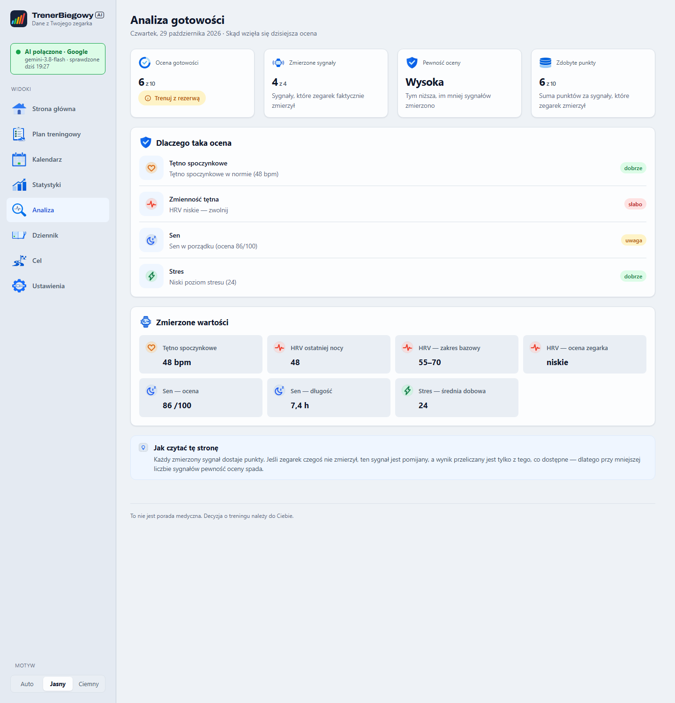

<h1>
  <picture>
    <source media="(prefers-color-scheme: dark)" srcset="docs/images/logo-dark.png">
    
  </picture>
</h1>

**Twój trening, dane z Garmina i plan na kolejny tydzień — w jednej aplikacji.**

TrenerBiegowyAI to lokalna aplikacja dla biegaczy korzystających z Garmin Connect. Pomaga przejrzeć sen, HRV, tętno i stres, zapisać samopoczucie, zaplanować tydzień oraz wysłać treningi na zegarek. Interfejs działa w przeglądarce na Twoim komputerze; AI jest opcjonalne.

> Aplikacja wspiera decyzje treningowe, ale nie udziela porad medycznych. Decyzja o treningu należy do Ciebie.

<picture>
  <source media="(prefers-color-scheme: dark)" srcset="docs/images/screenshot-dark.png">
  
</picture>

<sub>Widok dnia na danych demonstracyjnych. Motyw na GitHubie dopasowuje się do ustawień przeglądarki.</sub>

## Co możesz zrobić

- **Sprawdzić gotowość** — zobaczyć ocenę dnia, jej uzasadnienie i dostępność pomiarów snu, HRV, tętna spoczynkowego oraz stresu.
- **Ułożyć tydzień** — uwzględnić cel, dostępność, samopoczucie i przerwy; z pomocą AI przygotować plan i wysłać treningi do Garmina.
- **Porównać plan z aktywnościami** — przejrzeć kalendarz, czas i dystans biegów zapisanych przez zegarek oraz statystyki ostatnich tygodni.
- **Prowadzić dziennik** — zapisać samopoczucie, odczuwany wysiłek, ból i przerwy treningowe.
- **Kontrolować swoje dane** — wybrać, czy dane treningowe i zdrowotne mogą trafić do wskazanego dostawcy AI.

<picture>
  <source media="(prefers-color-scheme: dark)" srcset="docs/images/analysis-dark.png">
  
</picture>

<sub>Analiza oceny gotowości na tych samych danych demonstracyjnych.</sub>

## Instalacja na Windows

1. Pobierz najnowszą paczkę `TrenerBiegowyAI-<wersja>.zip` z [Releases](https://github.com/mdanielak/TrenerBiegowyAI/releases) i rozpakuj ją.
2. Uruchom `install.bat`. Instalator sprawdzi Pythona 3.11+, zainstaluje zależności i utworzy skrót na pulpicie. Jeśli Pythona nie ma, może zaproponować instalację przez `winget`.
3. Uruchom skrót **Trener Biegowy** lub `start.bat`. Aplikacja otworzy się pod adresem `http://127.0.0.1:8001`.
4. Połącz Garmin Connect, pobierz dane i przejdź przez kreator celu oraz dostępności.
5. Opcjonalnie skonfiguruj AI w **Ustawienia → AI** i zdecyduj o zgodzie na wysyłanie danych.

Bez AI możesz synchronizować i przeglądać dane, korzystać z dziennika oraz analizować gotowość. Układanie planu, rekomendacja dnia i komentarz do treningu wymagają połączenia z AI.

### Aktualizacja

Uruchom `update.bat`, aby pobrać najnowsze wydanie i zaktualizować aplikację. Możesz też przeciągnąć pobrany plik ZIP na `update.bat`. Dane lokalne, konfiguracja i własne plany są zachowywane. W kopii repozytorium Git aktualizacja używa `git pull`.

## Widoki aplikacji

| Widok | Co znajdziesz |
| --- | --- |
| **Dzisiaj** | Sygnały, gotowość, trening na dziś i synchronizację |
| **Plan treningowy** | Cel tygodnia, treningi dzień po dniu, porównanie czasu oraz wysyłkę do Garmina |
| **Kalendarz** | Zaplanowane treningi i aktywności z zegarka |
| **Statystyki** | Dystans, czas biegów, plan i trendy pomiarów |
| **Analiza** | Wyjaśnienie oceny gotowości i zmierzone wartości |
| **Dziennik** | Samopoczucie, RPE, ból, notatki i przerwy |
| **Cel** | Zapisany cel oraz opcjonalną strategię długoterminową |
| **Ustawienia** | Połączenia, profil, strefy tętna i cel |

Aplikacja ma jasny i ciemny motyw. **Auto** dopasowuje go do systemu.

## Dane i prywatność

Serwer aplikacji nasłuchuje lokalnie pod adresem `127.0.0.1`. Dane są przechowywane na komputerze, między innymi w:

- `local/` — profil, snapshot pomiarów, dziennik, preferencje i stan zadań;
- `training-plans/` — plany tygodniowe i własna strategia;
- `~/.GarminDb/` i katalogu danych GarminDB — dane pobrane z Garmina;
- `.env` — konfiguracja połączenia z AI i e-mail Garmin.

Synchronizacja wymienia dane z usługą Garmin. Funkcje AI wysyłają dane do skonfigurowanego dostawcy dopiero po włączeniu zgody w ustawieniach. Dostępne są konfiguracje zgodne z API OpenAI, w tym dostawcy zewnętrzni i lokalne Ollama. Warunki, limity i koszty zależą od wybranego dostawcy.

Hasło Garmin jest używane podczas logowania i nie jest zapisywane przez aplikację. Token konta pozostaje na komputerze i można go usunąć przez ustawienia zegarka. Klucz AI jest przechowywany jawnie w lokalnym pliku `.env`; nie udostępniaj go.

## Strategia i ograniczenia danych

Cel i dostępność zapiszesz w kreatorze. Fazy przygotowań i kryteria na stronie **Cel** pochodzą z opcjonalnego pliku `training-plans/long-term/half-marathon-2027.md`. Przykład znajduje się w [`przyklad-strategii.md`](training-plans/long-term/przyklad-strategii.md). Zmiana celu w kreatorze nie aktualizuje automatycznie strategii.

Snapshot obejmuje do 120 dni aktywności i 90 dni pomiarów zdrowia, licząc od najnowszych danych w GarminDB. Synchronizacja może być częściowa: przed decyzją treningową sprawdź aktualność i kompletność danych.

## Uruchamianie i rozwój

```bash
python -m pip install -r requirements-dev.txt
python -m pytest
python scripts/demo_server.py
```

Serwer demonstracyjny działa pod `http://127.0.0.1:8020`; zrzuty powyżej przedstawiają dane przykładowe. Pomoc CLI: `python -m trainer --help`. Najważniejsze polecenia to `setup`, `sync`, `today`, `plan`, `analyze`, `profile`, `zones`, `pause` i `doctor`.

Przed commitem możesz uruchomić `python -m trainer privacy-check`; hook projektu można włączyć poleceniem `git config core.hooksPath .githooks`.

## Licencja

Kod: [MIT](LICENSE). Krój Archivo: [SIL OFL 1.1](static/fonts/OFL-Archivo.txt). Zależności mają własne licencje. Aplikacja nie jest powiązana z firmą Garmin.
