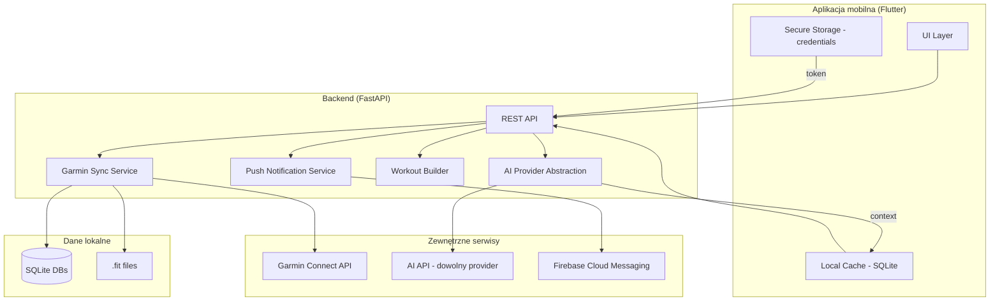

# Propozycja aplikacji mobilnej — Trener Biegowy AI

## 1. Ocena czy migracja ma sens

**TAK — migracja ma sens**, ale wymaga etapów pośrednich.

Obecny program to skrypty CLI bez interfejsu użytkownika. Aplikacja mobilna rozwiązuje:
- Brak automatyzacji (sync, rekomendacje, powiadomienia)
- Brak interfejsu mobilnego (dashboard, chat, historia)
- Brak push notifications (przypomnienia o treningach)
- Brak możliwości pracy w tle

Istniejąca logika (sync, analiza, tworzenie treningów) może zostać przeniesiona do backendu API, który będzie obsługiwał aplikację mobilną.

## 2. Proponowana architektura

**Rekomendacja: Opcja B — Flutter + FastAPI backend**

```
┌─────────────────────┐         ┌─────────────────────────┐
│   Flutter Mobile     │  REST   │     FastAPI Backend      │
│   (Android + iOS)    │◄──────►│     (Python 3.12+)       │
│                     │         │                         │
│  ┌───────────────┐  │         │  ┌───────────────────┐  │
│  │ Dashboard      │  │         │  │ /api/sync         │  │
│  │ History        │  │         │  │ /api/recommendation│  │
│  │ Chat           │  │         │  │ /api/plan          │  │
│  │ Settings       │  │         │  │ /api/chat          │  │
│  └───────────────┘  │         │  └───────────────────┘  │
│                     │         │                         │
│  ┌───────────────┐  │         │  ┌───────────────────┐  │
│  │ Local Cache    │  │         │  │ GarminDB           │  │
│  │ (SQLite)       │  │         │  │ (sync + store)     │  │
│  └───────────────┘  │         │  └───────────────────┘  │
└─────────────────────┘         │                         │
                                │  ┌───────────────────┐  │
                                │  │ AI Provider        │  │
                                │  │ (OpenAI/DeepSeek/  │  │
                                │  │  Anthropic/LOCAL)  │  │
                                │  └───────────────────┘  │
                                └─────────────────────────┘
```

### Dlaczego nie inne opcje?

| Opcja | Powód odrzucenia |
|---|---|
| A: Flutter + istniejący backend | Brak API, brak push notifications, brak安全 credential storage |
| C: Flutter local | Trudna integracja z Garmin (wymaga backendu), API keys na urządzeniu (niebezpieczne) |
| D: Inna | React Native — gorszy UX dla tej kategorii; Kivy — brak iOS |

## 3. Diagram architektury



## 4. Integracja z Garminem

### Oficjalne API

Garmin udostępnia **Garmin Health API** (wymaga partnerstwa):
- Nie jest dostępny dla zwykłych deweloperów
- Wymaga umowy partnerskiej i weryfikacji

### Nieoficjalne API (python-garminconnect)

Obecnie używane w projekcie:
- Logowanie: email + hasło + MFA
- Pobieranie: aktywności, sen, HRV, waga, RHR
- Tworzenie treningów: tak (workout API)
- **Ryzyko**: Garmin może zmienić API / zablokować konto

### Rekomendacja dla aplikacji mobilnej

**Backend proxy** — aplikacja mobilna NIE loguje się bezpośrednio do Garmin.
Zamiast tego:
1. Użytkownik loguje się do backendu
2. Backend loguje się do Garmin (token cached)
3. Aplikacja pobiera dane z backendu

### Dane dostępne z Garmin

| Kategoria | Parametry |
|---|---|
| Aktywności | dystans, tempo, HR, przewyższenia, cadence, power, VE, GCT |
| Zdrowie dzienne | RHR, kroki, stres, SpO2, kalorie |
| Sen | czas snu,_deep/rem/light, score, qualifier |
| HRV | tygodniowa średnia, ostatnia noc, baseline, status |
| Waga | pomiary wagi |
| Monitoring | kroki co minutę, HR ciągły |

## 5. Model danych

```python
# Modele Pydantic (backend)

class Activity:
    id: int
    date: datetime
    name: str
    type: str  # running/generic, walking/generic
    distance_km: float
    duration_min: float
    pace: str  # M:SS/km
    avg_hr: int | None
    max_hr: int | None
    avg_speed_kmh: float
    ascent_m: float
    training_effect: float
    anaerobic_training_effect: float

class DailyHealth:
    date: date
    rhr: int | None
    hr_min: int | None
    hr_max: int | None
    steps: int | None
    stress_avg: int | None
    spo2: float | None

class Sleep:
    date: date
    total_h: float
    deep_h: float
    light_h: float
    rem_h: float
    score: int | None
    qualifier: str | None

class HRV:
    date: date
    weekly_avg: int
    last_night: int
    baseline_low: int
    baseline_high: int
    status: str  # BALANCED, UNBALANCED, etc.

class Weight:
    date: date
    weight_kg: float

class TrainingPlan:
    id: int
    week_start: date
    days: list[PlannedWorkout]

class PlannedWorkout:
    day: date
    type: str  # easy, tempo, intervals, long, rest
    name: str
    description: str
    duration_min: int | None
    distance_km: float | None
    pace_target: str | None
    uploaded_to_garmin: bool

class ReadinessScore:
    date: date
    score: float  # 0-10
    rhr_score: float
    hrv_score: float
    sleep_score: float
    stress_score: float
    recommendation: str
```

## 6. Synchronizacja

### Synchronizacja danych

| Element | Mechanizm | Częstotliwość |
|---|---|---|
| Aktywności | GarminDB CLI → SQLite | Co 2-6h (WorkManager/BG Refresh) |
| Dane dzienne | GarminDB CLI → SQLite | Raz dziennie (noc) |
| Token refresh | Backend (automatycznie) | Przed wygaśnięciem |

### Synchronizacja treningów

| Element | Mechanizm | Kierunek |
|---|---|---|
| Plan → Garmin | Workout API | Backend → Garmin |
| Wykonanie → Historia | GarminDB sync | Garmin → Backend |

## 7. Background jobs

### Android (WorkManager)

| Zadanie | Typ | Częstotliwość | Warunek |
|---|---|---|---|
| Garmin sync | Periodic | Co 4h | WiFi, bateria > 20% |
| Poranna rekomendacja | Periodic | 7:00 codziennie | — |
| Niedzielny plan | Periodic | Niedziela 20:00 | — |
| Push notification | Event-driven | Po sync | Nowa aktywność |

### iOS (Background App Refresh)

| Zadanie | Częstotliwość | Niezawodność |
|---|---|---|
| Garmin sync | Co 4-6h | ~80% |
| Poranna rekomendacja | ~7:00 | ~85% |
| Niedzielny plan | ~20:00 | ~80% |

**Ważne**: iOS może opóźnić lub pominąć background refresh.
Rozwiązanie: Backend generuje rekomendacje i wysyła push niezależnie od app.

## 8. Powiadomienia

### Typy powiadomień

| Typ | Treść | Trigger |
|---|---|---|
| Nowa aktywność | "Nowy trening: Bieg 10km" | Po sync |
| Dzienna rekomendacja | "Dziś proponuję: Easy 6km" | 7:00 |
| Plan tygodnia | "Plan na tydzień gotowy" | Niedziela 20:00 |
| Przypomnienie | "Czas na trening!" | Zaplanowany czas |
| Ostrzeżenie | "HRV spada — rozważ odpoczynek" | Po sync |

### Implementacja

- **Android**: Firebase Cloud Messaging (FCM) + local notifications
- **iOS**: APNs + local notifications
- **Backend**: Wysyła push po wykryciu zdarzenia

## 9. Bezpieczeństwo

### Przechowywanie credentials

| Element | Miejsce | Szyfrowanie |
|---|---|---|
| Garmin credentials | Backend (server-side) | Plaintext w DB (szyfrowanej) |
| Garmin tokens | Backend (server-side) | Token cache |
| AI API keys | Flutter Secure Storage | Android Keystore / iOS Keychain |
| Token sesji | Flutter Secure Storage | Szyfrowany |
| Dane treningowe | Lokalna SQLite | SQLCipher (opcjonalnie) |

### Bezpieczeństwo API

- Wszystkie endpointy wymagają autoryzacji (JWT)
- Rate limiting na backendzie
- CORS whitelist
- HTTPS wymuszony
- Brak credentials w URL-ach

### Reguły dla dewelopera

1. NIGDY nie przechowuj credentiali w kodzie
2. Używaj zmiennych środowiskowych / secret manager
3. Tokeny Garmin NIGDY na urządzeniu mobilnym
4. AI API key przechowywany wyłącznie w Secure Storage
5. Logi nie zawierają danych wrażliwych

## 10. MVP — zakres

### Phase 1: Backend API (2-3 tygodnie)

- [ ] FastAPI setup + SQLAlchemy + SQLite
- [ ] Endpoints: /activities, /health, /sleep, /hrv, /weight
- [ ] Garmin sync service (wrapping istniejącej logiki)
- [ ] JWT auth
- [ ] Readiness assessment endpoint
- [ ] Training plan CRUD

### Phase 2: Flutter — Dashboard (2 tygodnie)

- [ ] Setup Flutter projekt
- [ ] Dashboard: dzisiejszy readiness, ostatnie treningi
- [ ] Historia treningów (lista + szczegóły)
- [ ] Wykresy (HR, tempo, dystans w czasie)
- [ ] Połączenie z backend API

### Phase 3: AI Integration (1-2 tygodnie)

- [ ] AI Provider abstraction (OpenAI-compatible)
- [ ] Dzienna rekomendacja (backend generuje)
- [ ] Plan tygodnia (backend generuje)
- [ ] Wybór providera w ustawieniach

### Phase 4: Chat + Notifications (1-2 tygodnie)

- [ ] Chat z trenerem AI (historia + kontekst)
- [ ] Push notifications (FCM/APNs)
- [ ] Background sync (WorkManager/BG Refresh)

### Phase 5: Polish (1 tydzień)

- [ ] UI/UX refinements
- [ ] Offline mode (cache readings)
- [ ] Error handling + retry logic
- [ ] Testing

## 11. Dalsze etapy rozwoju

### Po MVP

- **Automatyczny upload treningów**: AI generuje plan → backend uploaduje do Garmin
- **Zaawansowana analiza**: regression analysis, fatigue detection
- **Porównania**: porównanie z innymi biegaczami (anonimowo)
- **Eksport danych**: PDF reports, integracja z innymi narzędziami
- **Wielu użytkowników**: trener + podopieczni
- **Garmin Health API**: oficjalna integracja (wymaga partnerstwa)

## 12. Struktura projektu

```
trener-biegowy/
├── mobile/                          # Flutter app
│   ├── lib/
│   │   ├── main.dart
│   │   ├── models/                  # Data models (Activity, Plan, etc.)
│   │   │   ├── activity.dart
│   │   │   ├── daily_health.dart
│   │   │   ├── sleep.dart
│   │   │   ├── hrv.dart
│   │   │   ├── training_plan.dart
│   │   │   └── readiness.dart
│   │   ├── services/                # API client, storage
│   │   │   ├── api_service.dart
│   │   │   ├── storage_service.dart
│   │   │   └── notification_service.dart
│   │   ├── screens/                 # UI screens
│   │   │   ├── dashboard_screen.dart
│   │   │   ├── history_screen.dart
│   │   │   ├── chat_screen.dart
│   │   │   ├── plan_screen.dart
│   │   │   └── settings_screen.dart
│   │   ├── widgets/                 # Reusable components
│   │   │   ├── readiness_card.dart
│   │   │   ├── activity_tile.dart
│   │   │   └── chart_widgets.dart
│   │   └── providers/               # State management
│   │       ├── auth_provider.dart
│   │       ├── data_provider.dart
│   │       └── settings_provider.dart
│   ├── pubspec.yaml
│   └── android/ + ios/
│
├── backend/                         # FastAPI
│   ├── app/
│   │   ├── __init__.py
│   │   ├── main.py                  # FastAPI app
│   │   ├── config.py                # Settings
│   │   ├── database.py              # SQLAlchemy setup
│   │   ├── models/                  # DB models
│   │   │   ├── activity.py
│   │   │   ├── health.py
│   │   │   ├── plan.py
│   │   │   └── user.py
│   │   ├── schemas/                 # Pydantic schemas
│   │   ├── api/                     # API routes
│   │   │   ├── activities.py
│   │   │   ├── health.py
│   │   │   ├── plan.py
│   │   │   ├── ai.py
│   │   │   └── auth.py
│   │   ├── services/                # Business logic
│   │   │   ├── garmin_service.py    # Wrapping GarminDB
│   │   │   ├── ai_service.py        # AI Provider
│   │   │   ├── plan_service.py      # Training plan logic
│   │   │   └── notification_service.py
│   │   └── core/                    # Security, deps
│   │       ├── security.py
│   │       └── deps.py
│   ├── requirements.txt
│   └── alembic/                     # DB migrations
│
├── legacy/                          # Istniejące skrypty (zachowane)
│   ├── commands/
│   │   ├── sync.py
│   │   ├── analyze.py
│   │   └── workout_usage.py
│   └── workouts.py
│
└── docs/
    ├── ARCHITECTURE.md
    ├── MOBILE_APP_PROPOSAL.md
    └── windows_description.md
```

## 13. Koszty szacunkowe

| Element | Koszt miesięczny |
|---|---|
| Backend hosting (VPS/Railway) | $5-15 |
| Firebase (push notifications) | Darmowe do 50k |
| AI API (zależnie od użycia) | $5-20 |
| Domena SSL | Darmowe (Let's Encrypt) |
| **Razem** | **$10-35/miesiąc** |

Alternatywa: hostować backend lokalnie (Raspberry Pi / stary komputer) — $0.
